# Meridian Dock

GNOME Shell 50 extension. It's a system monitor that sits on the edge of the screen: clock, CPU, memory, disk, and network, drawn as dials. Process and connection lists are trays under the cards, and you can put a small pill in the top bar if you want those numbers up there too.

This started as a Conky config. The old `.conkyrc` and Lua dashboard are in [`legacy/`](legacy/). The extension keeps that general look, but it reads `/proc` in the Shell (NetworkManager for the local address), so it runs on Wayland. On Silverblue, Bazzite, or Kinoite you don't have to layer Conky onto the host.

GPL-3. See [LICENSE](LICENSE).

---

## Screenshots

<table>
  <tr>
    <td width="50%" align="center">
      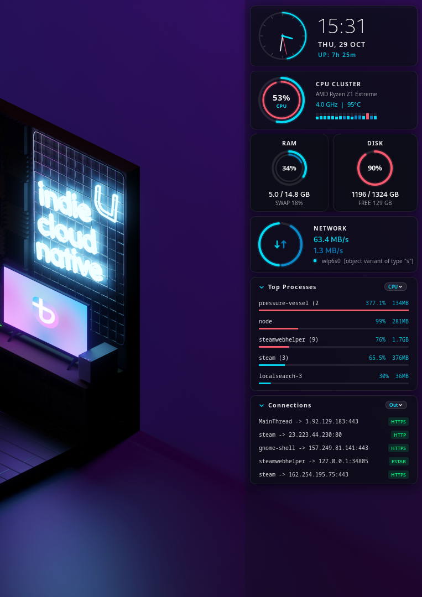<br>
      Right edge, trays open
    </td>
    <td width="50%" align="center">
      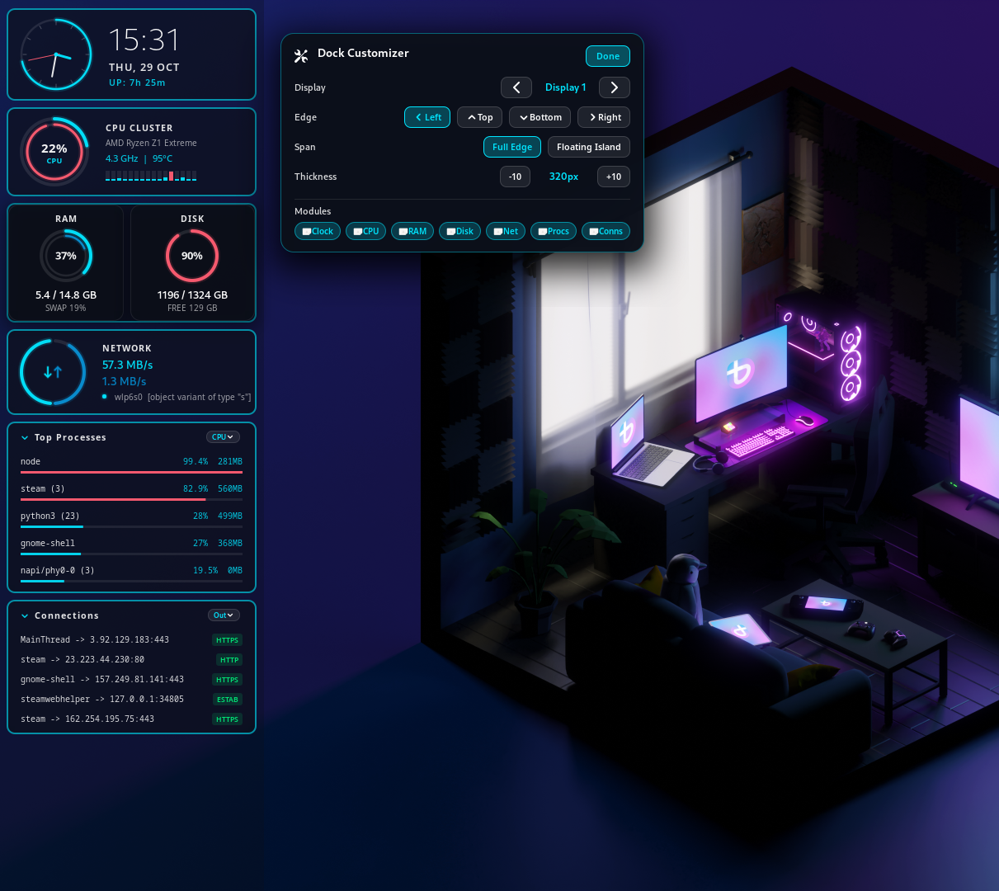<br>
      Left edge, customizer open
    </td>
  </tr>
  <tr>
    <td width="50%" align="center">
      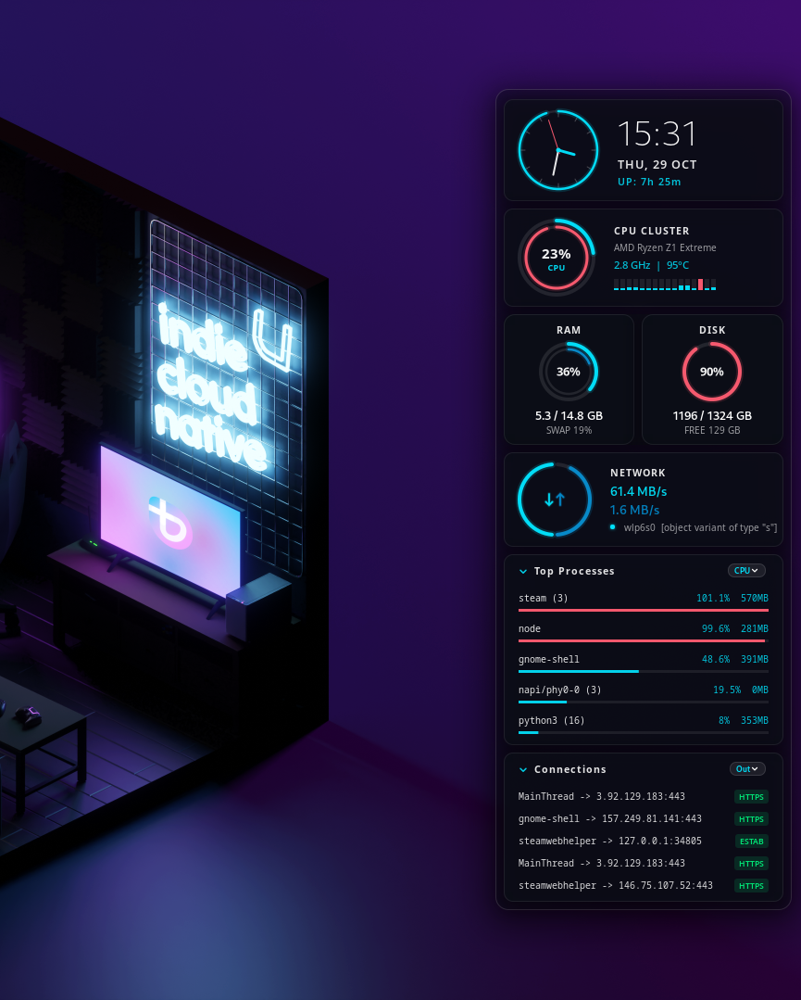<br>
      Floating Island, trays open
    </td>
    <td width="50%" align="center">
      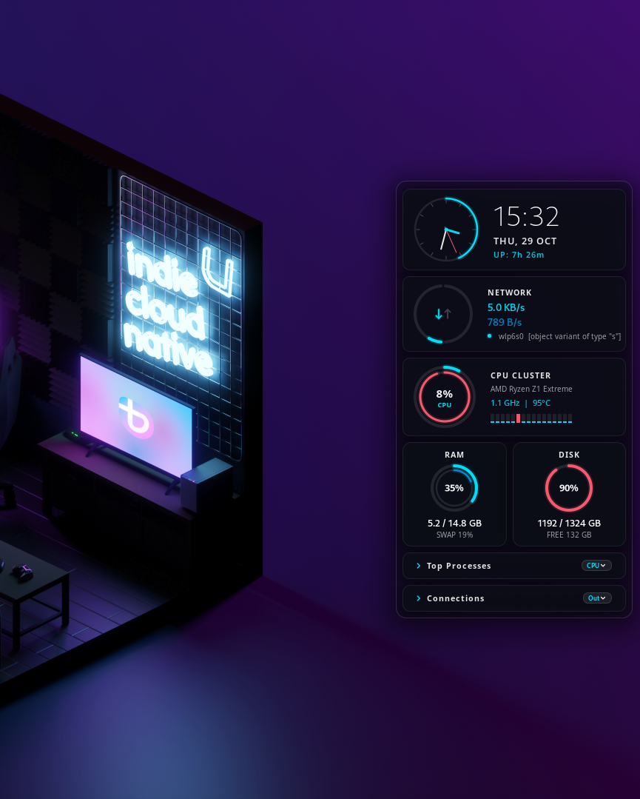<br>
      Floating Island, trays collapsed
    </td>
  </tr>
  <tr>
    <td width="50%" align="center">
      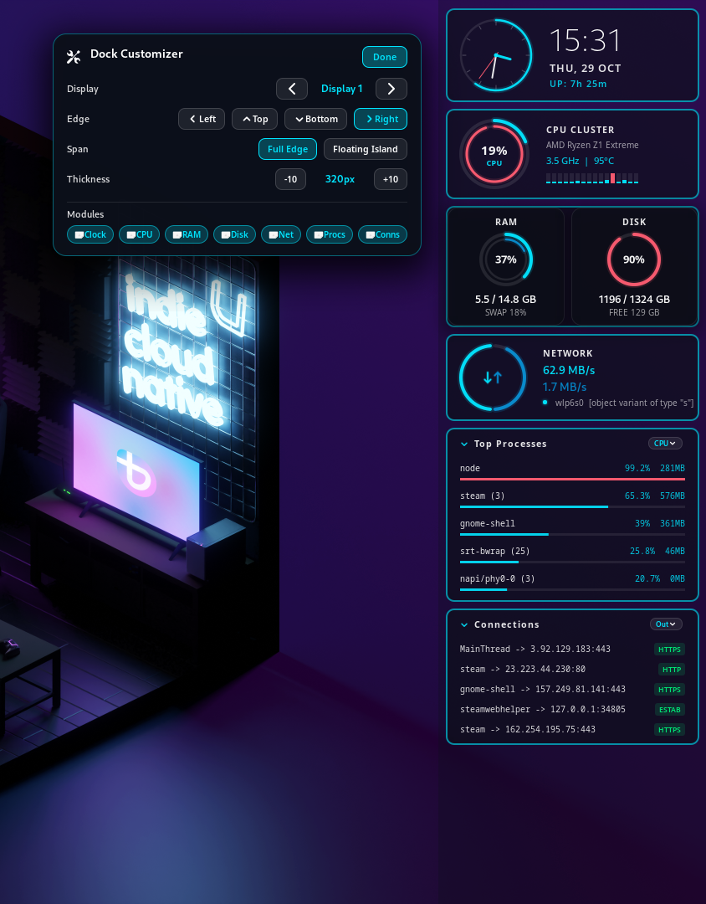<br>
      Customizer, full edge
    </td>
    <td width="50%" align="center">
      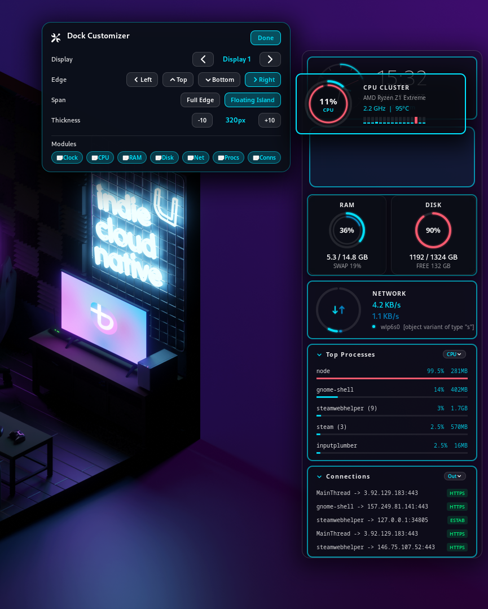<br>
      Customizer, card drag
    </td>
  </tr>
  <tr>
    <td width="50%" align="center">
      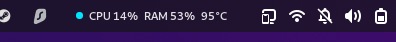<br>
      Top-bar pill
    </td>
    <td width="50%" align="center">
      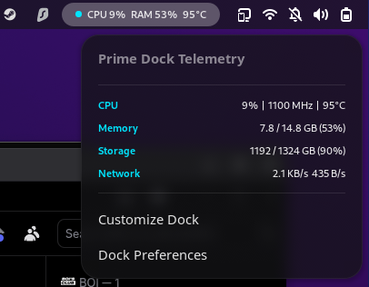<br>
      Top-bar menu
    </td>
  </tr>
</table>

<table>
  <tr>
    <td width="33%" align="center">
      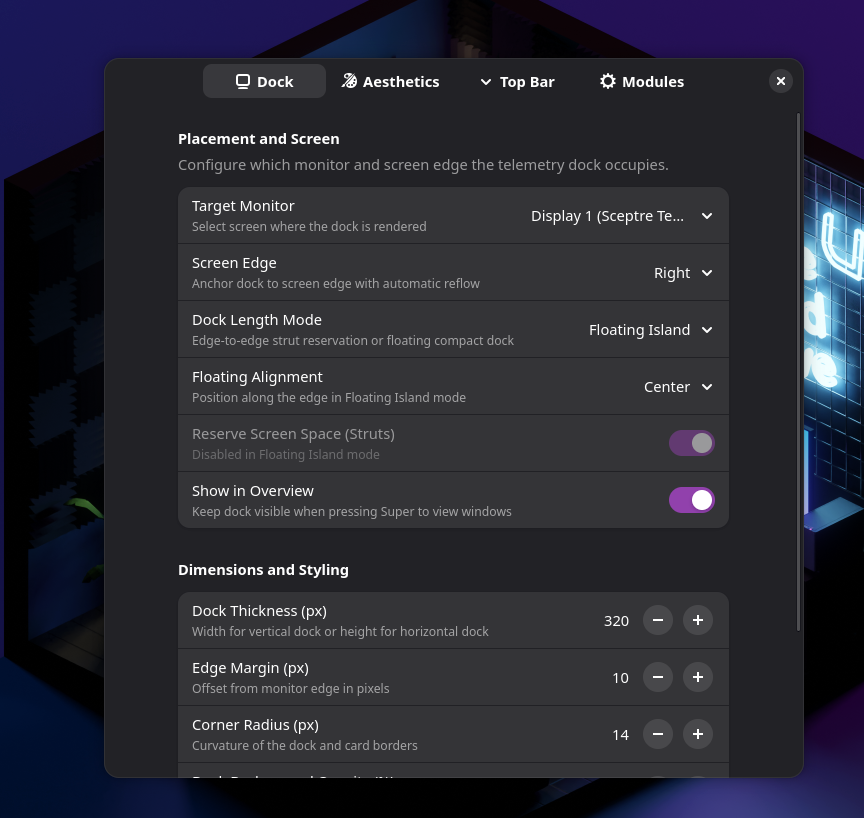<br>
      Dock
    </td>
    <td width="33%" align="center">
      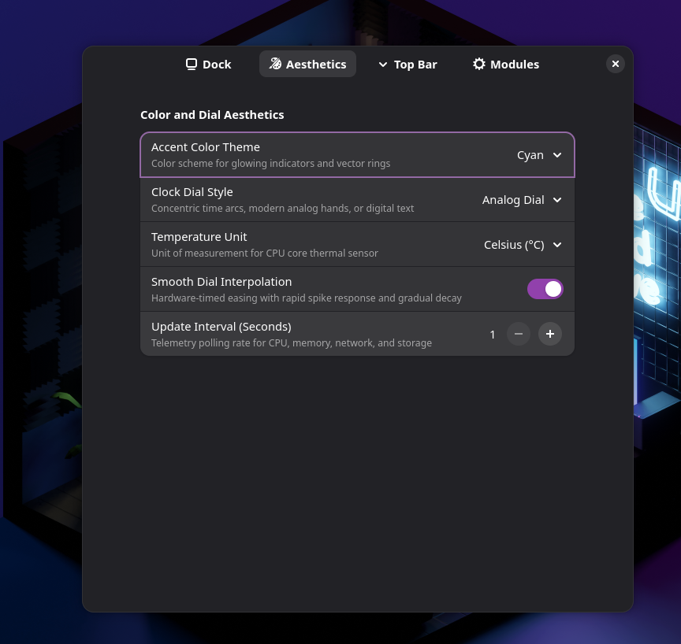<br>
      Aesthetics
    </td>
    <td width="33%" align="center">
      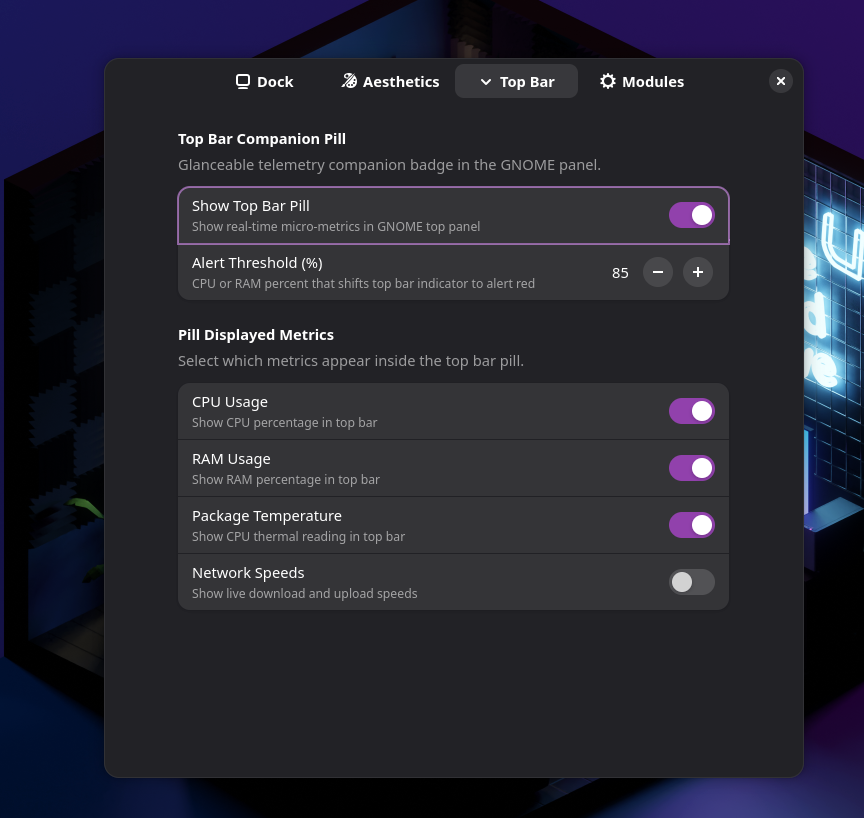<br>
      Top bar
    </td>
  </tr>
</table>

---

## Usage

Left, right, top, or bottom. **Full Edge** runs the length of that edge and can reserve the space, so maximized windows stop short of the dock. On a monitor with a top bar, a side dock starts under the bar instead of covering it. **Floating Island** is the short version, aligned to the start, center, or end.

`<Super>c` hides the dock and gives the edge back. `<Shift><Super>e` opens the customizer on the desktop: drag cards into a new order, change the edge, and turn modules on or off.

The cards:

- **Clock.** Rings, an analog face, or digital, plus uptime.
- **CPU.** Load, frequency, temperature, and a sparkline per thread.
- **Memory.** Used, total, and swap.
- **Disk.** `/` and home (`/var/home` or `/home`). If `/` is a tiny composefs, it shows the writable home filesystem instead.
- **Network.** Upload and download, the interface with the default route, and the local address from NetworkManager. If NetworkManager isn't there, the address comes from `/proc/net/fib_trie`.

**Top processes** is the busy stuff from `/proc`. Click a row to raise that app, or to open System Monitor when it's installed. **Connections** lists established and listening TCP from `/proc/net/tcp` and `/proc/net/tcp6`, with a process name when the socket inode matches. Those lists are only sampled while a tray is open, or while a horizontal dock is showing its collapsed summary.

The top-bar pill is optional. CPU, RAM, temperature, and network speeds, and it shifts color when CPU or RAM crosses the threshold you set. The menu opens the customizer and preferences.

Preferences are a normal Libadwaita window: monitor, edge, thickness, margin, corner radius, opacity, scale, and a theme (cyan, white, amber, or green). The clock can be rings, analog, or digital. Stats poll every 1 to 10 seconds. Module order is its own page.

---

## Install

You need GNOME Shell 50. This assumes the clone is at `~/src/meridian-dock`:

```bash
mkdir -p ~/.local/share/gnome-shell/extensions
ln -sfn ~/src/meridian-dock ~/.local/share/gnome-shell/extensions/meridian-dock@autumn
glib-compile-schemas schemas/
```

Then restart the Shell. On Wayland, log out and back in. On X11, Alt+F2 and `r`. Disable and enable won't pick up code changes, because the Shell keeps the JavaScript it already loaded.

```bash
gnome-extensions enable meridian-dock@autumn
```

Preferences are in the Extensions app, the top-bar menu, or `gnome-extensions prefs meridian-dock@autumn`.

The `/proc` parsers can be checked without loading the Shell UI:

```bash
gjs -m tests/test-engines.js
```

---

## Layout

`extension.js` is enable and disable. Preferences are `prefs.js` and the pages under `prefs/`. The Shell side is `src/`: `app.js` ties it together, `dock/` places the dock and handles dragging, `dials/` is the widgets, `metrics/` polls, and `engine/` reads `/proc` and D-Bus. `engine/` doesn't import Shell or GTK, so `tests/test-engines.js` can run under plain `gjs`.

Settings schema is `org.gnome.shell.extensions.meridian-dock`, named in `metadata.json`. The UUID is `meridian-dock@autumn`.

```plaintext
meridian-dock/
├── legacy/              # the old Conky config and Lua dashboard
├── extension.js
├── prefs.js
├── prefs/
├── src/
│   ├── app.js
│   ├── common/
│   ├── dock/
│   ├── metrics/
│   ├── dials/
│   └── engine/
├── screen-shots/
├── tests/
├── schemas/
├── stylesheet.css
├── metadata.json
├── LICENSE
└── README.md
```
